# KoTo.M – A Koopman toolbox for MATLAB

KoTo.M is the MATLAB toolbox accompanying the paper *"Implementation aspects of Koopman models with control – A tutorial"*. It extends and builds on the code of the [KOT-tutorial](https://github.com/KOT-tutorial/CDC26).

## Prerequisites

- [MATLAB](https://www.mathworks.com/products/matlab.html) R2022b or newer (developed with R2026a)
- Optional:
  - Toolboxes (only needed by some scripts):
    - Optimization Toolbox for the nonlinear least-squares fit in `identifyTCLab`
    - Statistics and Machine Learning Toolbox for the kernel liftings and multi-step windows in `learnDCMotor`
  - [uv](https://docs.astral.sh/uv/) (only needed to record new data)

## Installation

1. Clone this repository or download the code as a ZIP archive and extract it to a folder of your choice.

2. Open the folder in MATLAB and run

    ```matlab
    learnTCLab
    ```

   Each script calls `initWorkspace`, which sets up the MATLAB path.

## Scripts

| Script          | Description                                                                                         |
| --------------- | --------------------------------------------------------------------------------------------------- |
| `learnTCLab`    | Fits all Koopman forms and Willems' predictor to the TCLab data; phase portrait and error table     |
| `sweepTCLab`    | Sweeps the delay embedding and the amount of training data                                          |
| `learnTCLabFan` | Same comparison on the simulated TCLab with fan                                                     |
| `identifyTCLab` | Compares the physical ODE model (nonlinear least squares) with MOESP subspace models (not in paper) |
| `learnDCMotor`  | Additional example on a simulated DC motor (not in paper)                                           |

Generated figures are saved to `data/`.

## How does it work?

```mermaid
flowchart TB
    subgraph Learning
        direction LR
        Data@{shape: lean-l} -->|"$$\left\{\left(y_k,u_k\right)\right\}_{k=0}^{N}$$"| Scale1[Scaling]
        Scale1 -->|"$$\left\{\left(\overline{y}_k,\overline{u}_k\right)\right\}_{k=0}^{N}$$"| Embed1[Delay<br>Embedding]
        Embed1 -->|"$$\left\{\left(\zeta_k,\zeta_{k+1},\overline{u}_k\right)\right\}_{k=r}^{N-1}$$"| Lift1[Lifting]
        Lift1 -->|"$$\left(\Psi_X,\Psi_Y,U,V\right)$$"| Koopman[Koopman<br>Fitting]
    end
    Learning -->|"$$\left(A,B\right),\ \left(A,B,N_j\right),\ K,\ \left(\tilde{A}_{11},\tilde{A}_{12}\right)$$"| KR(Koopman<br>Predictor) --> Prediction
    subgraph Prediction
        direction LR
        Init[Initial Outputs]@{shape: lean-l} -->|"$$\left\{y_k\right\}_{k=0}^{r}$$"| Sum@{ shape: f-circ, label: "Junction" }
        Input[Input Sequence]@{shape: lean-l} -->|"$$\left\{u_k\right\}_{k=0}^{N-1}$$"| Sum
        Sum -->|"$$\left(\left\{y_k\right\}_{k=0}^{r},\left\{u_k\right\}_{k=0}^{N-1}\right)$$"| Scale2[Scaling]
        Scale2 -->|"$$\left(\left\{\overline{y}_k\right\}_{k=0}^{r},\left\{\overline{u}_k\right\}_{k=0}^{N-1}\right)$$"| Embed2[Delay<br>Embedding]
        Embed2 -->|"$$\left(\zeta_r,\left\{\overline{u}_k\right\}_{k=r}^{N-1}\right)$$"| Lift2[State<br>Lifting]
        Lift2 -->|"$$\left(z_r,\left\{\overline{u}_k\right\}_{k=r}^{N-1}\right)$$"| BilinearKoopman
        Lift2 -->|"$$\left(z_r,\left\{\overline{u}_k\right\}_{k=r}^{N-1}\right)$$"| InputLift

        subgraph RegularKoopman[Linear or Bilinear EDMDc]
            direction LR
            BilinearKoopman[Koopman<br>Rollout]
        end

        subgraph LiftedKoopman[GeKo or KCF]
            direction LR
            InputLift[Input<br>Lifting] -->|"$$\left(z_r,\left\{v_k\right\}_{k=r}^{N-1}\right)$$"| KoopmanPredictor[Koopman<br>Rollout]
        end
        
        BilinearKoopman -->|"$$\left\{\widehat{z}_k\right\}_{k=r}^{N}$$"| Junction@{ shape: f-circ, label: "Junction" }
        KoopmanPredictor -->|"$$\left\{\widehat{z}_k\right\}_{k=r}^{N}$$"| Junction --> Projection
        Projection -->|"$$\left\{\widehat{\zeta}_k\right\}_{k=r}^{N}$$"| Unembed[Output<br>Extraction]
        Unembed -->|"$$\left\{\widehat{\overline{y}}_k\right\}_{k=r}^{N}$$"| Scaling2[Unscaling]
        Scaling2 --> OutputSequence["$$\left\{\widehat{y}_k\right\}_{k=r}^{N}$$"]
    end
```



Notation follows the paper: $y_k$ and $u_k$ are the measured outputs and inputs, $\zeta_k$ is the delay-embedded state with $r = \max(r_y, r_u)$, $z_k = \Psi(\zeta_k)$ and $v_k = \Psi^u(u_k)$ are the lifted state and lifted input, and $\Psi_X$, $\Psi_Y$, $U$, $V$ are the data matrices from Algorithm 1. A bar $\overline{\bullet}$ marks scaled quantities and a hat $\widehat{\bullet}$ marks predicted ones.

## Project Structure

```bash
├── data              # TCLab training and test data (.mat), generated figures
│   └── raw           # raw TCLab recordings (.npz)
├── liftings          # delay embeddings and state/input liftings
├── predictors        # Koopman forms, Willems' predictor, MOESP and nonlinear least-squares fit
├── systems           # simulation models of the TCLab (with fan) and the DC motor
└── utils             # scaling, plotting, data generation and collection
    ├── shims         # compatibility functions for older MATLAB releases
    └── TCLab-sketch  # Arduino firmware for the TCLab
```

## Recording new data

The recorded TCLab data used in the paper are included in `data/`. To record new data, flash the firmware in `utils/TCLab-sketch` to the TCLab, connect it via USB and run

```bash
uv sync
uv run utils/data_collector.py  # records experiments to data/raw
uv run utils/npz_to_mat.py      # converts and splits them into data/TCLabTrainXX.mat and data/TCLabTestXX.mat
```

## License

This project is licensed under the MIT license, except for `utils/TCLab-sketch`, which is licensed under the Apache License 2.0 (see its `LICENSE` file).

<!-- ## Citation

If you use this toolbox, please cite the paper:

```bibtex
@inproceedings{erdin2027koopman,
  author    = {Erdin, Alex and Venkatasubramanian, Janani and Bold, Lea and Worthmann, Karl and Lazar, Mircea and Faulwasser, Timm},
  title     = {Implementation aspects of Koopman models with control – A tutorial},
  booktitle = {Proc. 25th European Control Conference (ECC)},
  year      = {2027},
  note      = {Invited session paper},
  pages     = {},
  doi       = {},
}
``` -->

## Support

For any questions or issues related to this code, please contact the authors:

- Alex Erdin (TU Hamburg): [alex.erdin@tuhh.de](mailto:alex.erdin@tuhh.de)
- Mircea Lazar (TU Eindhoven): [m.lazar@tue.nl](mailto:m.lazar@tue.nl)

We appreciate any feedback, bug reports, or suggestions for improvements.
