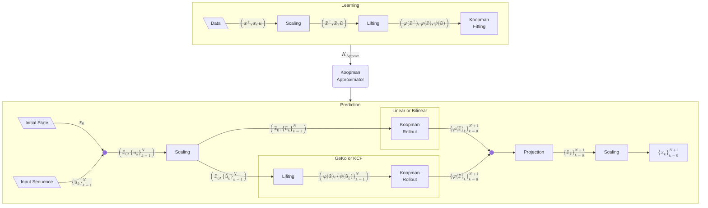

# EEC27 Koopman Tutorial

This repository holds the MATLAB code for the tutorial paper: *"A TCLab tutorial on Koopman control methods"*.

> [!warning]
> Update the title once the paper is submitted!

## Prerequisites

- [MATLAB R2026a](https://uk.mathworks.com/products/matlab.html)

## Installation

1. Clone this repository or download the code as a ZIP archive and extract it to a folder of your choice.

2. To initalize the workspace run the following script

    ```matlab
    initWorkspace.m
    ```

3. Run the simulation with

    ```matlab
    learnTCLab.m
    ```

## How does it work?



## License

This project is licensed under the MIT license.

## Support

For any questions or issues related to this code, please contact the authors:

- Alex Erdin: [alex.erdin@tuhh.de](mailto:alex.erdin@tuhh.de)
- Lea Bold: [lea.bold@tu-ilmenau.de](mailto:lea.bold@tu-ilmenau.de)

We appreciate any feedback, bug reports, or suggestions for improvements.
